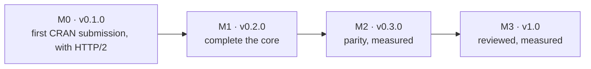

# zuhttp Roadmap

**Edition:** 2 — from v0.1.0 to 1.0, written 2026-09-25; M4 (1.1.0, HTTP/2) added 2026-11-03 and folded into M0 2026-11-04 (D-96)
**Companion:** [zuhttp-design.md](zuhttp-design.md), edition 2 — every work package cites the sections and decisions it implements
**History:** [history/roadmap-v1.md](history/roadmap-v1.md) — edition 1 verbatim: stages S0–S21 and U1–U6, how each landed, the 2026-09-22 review and the amends merged with it
**Status:** M0 reopened 2026-11-04 for HTTP/2 (W20–W22, D-96); the 0.1.0 submission (#40) waits on them. 0.1.0 is the first CRAN submission (D-82); each submission is tagged when `CRAN-SUBMISSION` is committed (D-111)

---

## Where 0.1.0 left things

v0.1.0 is a working HTTP/1.1 client on three platform TLS stacks: verbs,
clients and composition; strict framing; redirects; proxies and CONNECT;
gzip; a pool that is fork- and session-safe; memory, file and callback sinks;
retries, middleware and hooks; mock and cassette transports; timings, a
redacted event trace, and structured conditions. All 13 §31.16 workflows
pass. It was built in four days as one squashed PR.

What it does not yet have is the second half of the design's promises, and
the evidence for several of the first half:

| Gap | Where it stands | Owner |
|---|---|---|
| Phase timeouts | only `total` exists; no request has ever timed out in a test | W4, W7 |
| Custom CAs on Windows | refused | W8 |
| Pinning on macOS and Windows | refused | W9 |
| Revocation on OpenSSL | refused, with no way to supply a source | W10 |
| Ctrl-C bound, leaks under interrupt | unmeasured | W11 |
| Cancellable DNS | not bounded by `timeout` or Ctrl-C | W13 (macOS), W14 |
| macOS engine | Secure Transport is deprecated, caps at TLS 1.2 and NOTEs under `--as-cran` — the one NOTE that blocks a CRAN submission; Network.framework is decided (D-63) and measured | W13 |
| Windows TLS 1.3 | blocked on an unverified ABI | W15 |
| Performance | unmeasured against every §51.3 runtime threshold | W18 |
| Evidence in CI | pull requests from this repository ran **no CI** until W1; the Linux certificate matrix had never run until 2026-09-25 | W1 |

The last row is the one that shaped this plan. Edition 1's rule 2 said a
stage is done when its criteria pass in CI, and for most of 0.1.0's life the
CI could not show it: merges were untested, the squash erased per-stage
evidence, and the OpenSSL certificate matrix skipped itself on every run.
Edition 2 therefore starts with the machinery that makes "done" checkable.

---

## Rules

1. **A work package is done when its exit criteria pass in CI on a pull
   request**, not when the code works locally. (Edition 1 rule 2, with the
   pull request made explicit — D-70.)
2. **No work package is "mostly done".** A criterion that cannot be met yet
   stays unticked with a reason; the package stays open.
3. **Status never goes in a heading.** It goes on a `**Status:**` line. Issues
   link to headings by anchor; a heading that changes with its status breaks
   every link. This is also why the edition 1 stage headings survive, below.
4. **One pull request per work package.** Large packages may use several, each
   green; none bundles two packages.
5. **The test comes first.** A package's tests land before or with it. A test
   for behaviour not yet built is `skip()`ped naming the package, so a gap
   reads as a gap.
6. **Every test that guards a mechanism is shown to fail once.** Break the
   mechanism, watch the test fail, restore. Say so in the PR. The suite has
   passed for the wrong reason at least four times: a constant clock read as
   monotonic; a pin test accepted a refusal; a revoked host "failed" under a
   policy that failed every host; a certificate matrix skipped itself.
7. **Findings go in the log at the end, dated, append-only.** A finding that
   changes the specification also changes the design, in the same commit.

---

## Milestones

| Milestone | Version | Theme | Work packages | Gate |
|---|---|---|---|---|
| M0 | 0.1.0 | on CRAN, with HTTP/2 | W1, W2, W3, W6, W13, W16, W20, W21, W22 | `zugrpc`'s Stage 4 live test passes against zuhttp; accepted on CRAN; tagged at submission (D-111) |
| M1 | 0.2.0 | the design's promises, tested | W4, W7–W12 | every `zu_tls()` setting works on every backend except TLS 1.3 on Windows; phase timeouts |
| M2 | 0.3.0 | parity, measured | W14, W15, W18 | §61.4 and §61.5 measured; TLS 1.3 on Windows or scope cut 1 taken |
| M3 | 1.0 | others may depend on it | W17, W19 | all 14 §61 criteria; external review; `SECURITY.md` |
| M4 | — | folded into M0 (D-96) | — | — |

D-55 holds from the first CRAN acceptance on: 0.x.y patch releases carry
fixes only; features wait for the next minor. Before it, 0.1.0 is unreleased
and takes the M0 work packages (D-82).

**Versions are tagged at submission** (D-111, superseding D-82's tagging
clause). Committing `CRAN-SUBMISSION` runs `cran-release.yaml`: it tags the
submitted commit with the bare version, publishes the GitHub release and opens
the `.9000` bump, which merges once CRAN accepts. A resubmission moves the tag.

### M0 — v0.1.0: first CRAN submission

**Status:** reopened 2026-11-04 — HTTP/2 (W20–W22) joins 0.1.0 (D-96). Was ready to submit on `main` at `0706937`. Tracker: #21; the submission itself is #40, which waits on W22.

0.1.0 is submitted with what shipped, plus the work that either blocks a
submission or is far cheaper before one (D-82). Everything else follows on
CRAN as 0.2.0 and later; the settings it lacks are refused with
`zu_tls_unsupported_error`, never downgraded (D-56), so a gap is a missing
feature and not a defect.

**Done**

- [x] Merge the review (#20), with its amends: D-54, D-55 and D-56 accepted;
      #12, #14 and #52 closed; #5 and #6 reduced to their implementation
      halves; the Linux certificate matrix running.
- [x] Fix the seven blockers of the 2026-09-26 architecture review (#73):
      C-1, R-1, R-2, R-3, R-4, CI-1, CI-2, each with a test that failed
      first (#74).
- [x] Fix the 13 findings of the 2026-09-27 package review (#76), each with a
      test that failed first (#77): D-76 to D-81.
- [x] Fix the 2026-10-30 critical review of `237bf96` (#91–#120), and the
      Schannel defect it led to (#123): D-83 to D-87, in #121. The README's
      eMudhra claims measured (#122); `zujson` replaces `jsonlite` and
      `zu_resp_xml()`/`zu_resp_html()` join 0.1.0 (#124, D-88). Full profile
      green on #124 (`f09eff4`), and every workflow green on `main` after
      #121 and #122 (`fbb1775`).
- [ ] Fix the 16 findings of the 2026-11-09 consolidation of three outside
      reviews of `90832db` (#208–#223; `.agents/reviews/2026-11-09-fable.md`),
      each with a test that failed first. #208, #209 and #215 are release
      blockers: a 32–64 KiB HTTP/1.1 upload is sent twice, an open streamed
      body is not fork-guarded, and the OpenSSL backend keeps a pointer to a
      stack-local `zuh_tls_config`. The OpenSSL backend runs under ASan in CI
      before this is ticked.
- [x] Close the edition 1 stage issues #41–#51 as superseded (2026-09-26).
- [x] One issue per work package (#60–#71), and the trackers re-scoped to
      D-82: #21 is M0, #72 is M1, #22 is the path to 1.0.

**Order, and why.**

1. **W1 first.** Until pull requests run CI, rule 1 cannot be satisfied by
   anything else on this list, and CRAN-like checks (R-devel on Windows, the
   r-devel containers, sanitizers, rchk) are what stand in for win-builder.
2. **W2 second.** The C prefix rename touches every C file; done after W13 it
   would rename the new backend too.
3. **W3 and W6** while nothing depends on the package (R-11): trimming exports
   and fixing defaults is free now and a deprecation cycle once on CRAN.
4. **W13.** The pragma that silences Secure Transport's deprecations is an
   `--as-cran` NOTE, and CRAN's pretest does not read explanations. It also
   moves the §9 seam (D-71), so W7, W9 and W11 are later built once, on the
   engine that ships.
5. **W16 last**: `cran-comments.md`, the missing-OpenSSL path, and a green
   full run on the commit that is submitted.

**Exit criteria**

- [x] W1, W2, W3, W6, W13 and W16 closed (#84–#89).
- [x] `R CMD check --as-cran` on the submitted tarball: 0 errors, 0 warnings,
      and the "New submission" NOTE only (`0706937`, locally; the one other
      NOTE is the local machine's HTML Tidy).
- [x] A green full-profile run of every workflow on the submitted commit
      (`0706937`, all ten workflows; #89's full run: 0 notes on every leg).
- [x] NEWS lists every user-visible change since the 0.1.0 entry was first
      written, including D-65's removals, D-68 and D-69.
- [ ] Submitted (#40); accepted. `cran-release.yaml` tags `0.1.0` and
      publishes the release when `CRAN-SUBMISSION` is committed (D-111);
      the `.9000` bump merges after acceptance.

### M1 — v0.2.0: complete the core

**Status:** not started. Blocked on M0. Tracker: #72.

**Order, and why.**

1. **W4 before W7.** Phase timeouts are built against tests that already make
   real requests time out, rather than against synthetic conditions.
2. **W7–W11 in any order**, in parallel if there are two people: they touch
   different files (`zuh_engine.c`/`zuh_net.c`; `zuh_tls_schannel.c`;
   `zuh_spki.c` plus two backends; `zuh_tls_openssl.c`; `init.c` and the
   test harness).
3. **W12** last, because three of its four documents describe W7–W10.

**Exit criteria**

- [ ] W4 and W7–W12 closed.
- [ ] `zu_info()$tls_capabilities` is all five on macOS; `pins, ca_file,
      ca_extra, revocation` on Windows; all five on OpenSSL when `crl_file` is
      set.
- [ ] Project-owned C ≤ 10,000 code lines (§51.3, D-97), measured by W1's job.
- [ ] NEWS lists every user-visible change.

### M2 — v0.3.0: parity, measured

**Status:** not started. Blocked on M1.

**Order.** W18 first — measuring against `curl` is cheap and an unfavourable
number can still change the plan (R-7). It used to come before CRAN for that
reason; D-82 moved the submission ahead of it, accepting that a premise that
fails is then found on CRAN rather than before. W14 and W15 in parallel.

**Exit criteria**

- [ ] W14, W15 and W18 closed.
- [ ] §61.5 and §61.4 measured and published in the README, even if unfavourable.

### M3 — 1.0

**Status:** not started.

**Exit criteria** — "What 1.0 means", below.

### M4 — v1.1.0: HTTP/2 for gRPC

**Status:** folded into M0 on 2026-11-04 (D-96). W20–W22 are M0 work
packages, its exit criteria below are M0's, and its tracker #128 is closed in
favour of #21. The heading stays so that links to it resolve (rule 3).

HTTP/2 through vendored nghttp2 (design §60, §65, D-89 to D-95), so that
`zugrpc` (RFC 0069 in `pedrobtz/packages`) can be a pure-R gRPC client on
zuhttp's request API and `zuspark` (RFC 0070) a Spark Connect client on it.
It ships in 0.1.0 rather than 1.1.0 (D-96): nothing in M1–M3 is a
prerequisite, and waiting would put four zuhttp releases and the 1.0 review
in front of both consumers.

**Order, and why.**

1. **W20 first.** Nothing else can be tested until nghttp2 compiles cleanly
   on every §52 leg and a request negotiates `h2`; the symbol scan is the
   one criterion that could send the whole plan back to the design (R-19).
2. **W21 second.** Trailers, the pull stream, cancellation and keepalive are
   one package because they share the stream's lifetime: a pulled body that
   is aborted mid-window on a pooled connection is where the bugs are, and
   they show only with all four present.
3. **W22 last.** Client streaming has one consumer call (`AddArtifacts`)
   and waits until `zugrpc` is on the air with the first two.

**Exit criteria** — part of M0's since 2026-11-04.

- [ ] W20, W21 and W22 closed.
- [ ] `zugrpc`'s Stage 4 live test (grpc-go interop server in Docker)
      passes against this branch of zuhttp, on the Ubuntu legs. *Open:
      zugrpc has Stages 0–1; zuhttp's own calls to the same server pass in
      test-http2.R (unary, Trailers-Only, server streaming, full duplex).
      This gates #40, not W22.*
- [x] Every §65 subsection reads Built; D-89 to D-95 read Accepted.
- [x] Project-owned C ≤ 10,000 code lines (D-97) with the HTTP/2 driver in, by W1's
      job (8,669 after W22); the §51.3 total-C row restated from the measured build.
- [x] Every HTTP/1.1 test passes unchanged: HTTP/2 off is HTTP/1.1 as
      shipped — but for two network tests that assumed example.com answers
      HTTP/1.1, recorded under W20.
- [x] NEWS lists every user-visible change.

---

## Work packages

Each package lists the design sections and decisions it implements, the issue
it closes, what it depends on, an estimate in focused working days with a
confidence, and exit criteria written so that each can fail.

### W1 — CI on every pull request, and to the family standard

**Status:** done (#84, merged 2026-10-29). **Milestone:** M0. **Closes:** #18. **Implements:**
D-70, §44, §48, §61.13. **Estimate:** 2 days, high.

Every job in every workflow carries `if: github.event_name != 'pull_request'
|| <fork>` while `push` fires only on `main`/`develop`, so a pull request
from this repository runs nothing. That comes first. The rest is #18.

**Exit criteria**

- [x] A pull request from a branch of this repository runs every workflow;
      demonstrated on this package's own PR (#84).
- [x] R CMD check through `pedrobtz/r-actions` at `@v1`, including the
      CRAN-like containers and a Windows R-devel leg; `coverage.yaml` pinned to a commit.
      The `coverage.yaml` half is done (#74, zucrypt's `68c22c1`).
- [x] rchk and a sanitizer build over `src/init.c` in CI.
- [x] `tools/vendor/{manifest.tsv,checksums.sha256,verify}`, run in CI;
      editing one vendored byte fails it.
- [x] `tls-spike.yaml` renamed for what it does (`network.yaml`); README badges
      follow.
- [x] `dash -n` over `configure`, `configure.win` and `cleanup`.
- [x] `library(httr2); library(zuhttp)` emits no masking message, asserted (§61.13).
- [x] A job prints project-owned code lines on every PR and fails above 8,000
      (R-4).

### W2 — Internal C prefix `zuh_`, hidden symbols

**Status:** done (#85, merged 2026-10-29). **Milestone:** M0. **Closes:** #15. **Implements:**
D-66, D-54. **Estimate:** 1 day, high. **Depends on:** W1.

A mechanical rename of internal C identifiers from `zu_`/`ZU_` to
`zuh_`/`ZUH_` (never `zu_int_`, which is `zukomp`'s), plus
`$(C_VISIBILITY)`. The R prefix does not change.

**Exit criteria**

- [x] No `zu_`/`ZU_` identifier remains in `src/` outside comments that cite
      R functions; `ctest/` and `fuzz/` follow.
- [x] `test-abi.R`: the shared object exports only `R_init_zuhttp`.
- [x] A CI step compiles `src/zuh_error.h` and `src/zuh_buffer.h` together
      with `zukomp.h` (fetched at a pinned commit) and succeeds.
- [x] Design §1.1 and §11 updated in the same PR.

### W3 — Export surface and `zuhttp_error`

**Status:** done (#86, merged 2026-10-29). **Milestone:** M0. **Closes:** #19. **Implements:**
D-65, §53, §34.1. **Estimate:** 1.5 days, high.

**Exit criteria**

- [x] 61 exports: the 75 before W3 minus exactly the 14 removals in design §53
      (D-65 as amended 2026-10-29: `zu_redact_headers()`, `zu_redact_params()`
      and `zu_set_json_backend()` stay).
- [x] Every condition inherits `zuhttp_error` directly above `error`, from the
      C chain (`zuh_code_class_chain()`), not from R.
- [x] Testing tools carry an "experimental" lifecycle note in their help.
- [x] README's "the API is expected to be stable" becomes true, and says
      which functions are experimental.

### W4 — Test infrastructure: local httpbin, real timeouts, lifecycle

**Status:** not started. **Milestone:** M1. **Closes:** #50 (edition 1's U2
groups A–D). **Implements:** §50.4, §50.6. **Estimate:** 3 days, medium.
**Depends on:** W1.

**Exit criteria**

- [ ] go-httpbin runs on all three CI runners; every test and `ctest` call
      that reached `httpbin.org` goes through `ZU_HTTPBIN_URL` instead.
- [ ] A request actually times out: `/delay/5` with `timeout = 1` raises
      `zu_timeout_error` in under 2 s; `/delay/1` with `timeout = 10`
      returns 200. Both, because the first alone passes for a client that
      always times out.
- [ ] A stall mid-body (a server that sends headers and stops) raises within
      `timeout`. This is the fixture W7's `read` timer is built against.
- [ ] `test-lifecycle.R`: the pool finalizer runs under `gc()` and closes its
      sockets; a finalizer in a forked child does not close the parent's.
      Each shown to fail with its mechanism disabled.
- [ ] badssl rows A2–A5: TLS 1.0/1.1 and RC4/DH1024 refused; SHA-1
      intermediate and no-CN certificates rejected; `incomplete-chain`
      recorded per backend.
- [ ] `tests/spelling.R` with `inst/WORDLIST`.

### W6 — Correct two shipped defaults

**Status:** done. **Milestone:** M0. **Implements:** D-68, D-69,
§19.4, §21.4. **Estimate:** 0.5 day, high.

**Exit criteria**

- [x] `redirects` defaults to 10; a 3-hop redirect chain succeeds with the
      default client. (#55; an exhausted chain now raises.)
- [x] `max_decompression_ratio` defaults to 1000 and is passed at
      `zuh_body.c:35`; a bomb fails after less than 1 MB of output, with the
      absolute cap raised out of the way to prove it is the ratio that fired.
      Measured with 100 MB of zeros as ~100 KB of gzip: deflate cannot reach
      the 100,000:1 of "1 KB → 100 MB", its ceiling is about 1030:1.
- [x] Both in NEWS: as what 0.1.0 does, since neither shipped a release.

(W5 is retired: it was "tag v0.1.0", which `cran-release.yaml` now does at submission, D-111.)

### W7 — Phase timeouts

**Status:** not started. **Milestone:** M1. **Closes:** #13, #41.
**Implements:** D-57, D-58, §24. **Estimate:** 3 days, medium.
**Depends on:** W4.

**Exit criteria**

- [ ] `zu_timeout(total, connect, read, write)`; `timeout =` accepts it or a
      number everywhere; `zu_req_timeout()` sets any subset; merging follows
      §31.9.
- [ ] Each phase fires with its own `phase` in the condition, against W4's
      fixtures: `connect` against a non-routable address, `read` against a
      mid-body stall, `total` across a redirect chain and across retries.
- [ ] `read` does not fire on a slow transfer that keeps moving (a 5 s
      trickle with `read = 1`).
- [ ] `zu_info()` and `print(client)` show the timeout model.
- [ ] Offline: §24.2 composition arithmetic in `ctest`.

### W8 — Windows custom CAs, and the certificate matrix on Windows

**Status:** not started. **Milestone:** M1. **Closes:** #5, #43 (with W9,
W15). **Implements:** D-61, §14.3, §50.5. **Estimate:** 4 days, **low** —
CryptoAPI chain engines, no local Windows machine.

The matrix fixture needs a POSIX shell only to capture the `s_server` PID.
Port it with `processx` in Suggests, which gives a PID on every platform;
Windows runners ship an `openssl` CLI with Git.

**Exit criteria**

- [ ] First, an S1-style probe on CI: Rtools' `wincrypt.h` declares
      `CERT_CHAIN_ENGINE_CONFIG.hExclusiveRoot` and
      `CERT_CHAIN_EXCLUSIVE_ENABLE_CA_FLAG` (if not, D-61 is revised before
      any backend code is written).
- [ ] The §50.5 matrix runs on the Windows CI leg — every row, not a subset.
- [ ] `ca_file` and `ca_extra` rows pass on Windows with the same
      certificates as elsewhere: `ca_extra` + public host → 200; `ca_file` +
      public host → `zu_tls_certificate_error`.
- [ ] An expired certificate under `ca_extra` is rejected — D-61's second
      pass must not rescue a chain that failed for a reason other than its
      root.
- [ ] A malformed PEM raises `zu_tls_error` naming the file.
- [ ] Before writing the backend code, an interactive debugging session on a
      Windows runner is available (tmate or equivalent): nine blind CI rounds
      in S8 are not repeated.

### W9 — Pinning on macOS and Windows

**Status:** not started. **Milestone:** M1. **Closes:** #4, #12 (its
implementation half), #42, #44 (pin rows). **Implements:** D-60, §14.4.
**Estimate:** 3 days, medium.

**Exit criteria**

- [ ] `src/zuh_spki.c` (or `zuh_spki.c` after W2): the bounded DER walker, no
      allocation, ≤ 150 lines.
- [ ] `ctest`: the walker and OpenSSL's `i2d_X509_PUBKEY` agree on a corpus of
      at least 20 real certificates (RSA, EC P-256, P-384, Ed25519); every
      truncation of each is rejected without a read past the buffer, under
      ASan.
- [ ] Fuzz target 10, with that corpus as seeds.
- [ ] The three §50.5 pin rows pass on all three backends.
- [ ] `zu_info()$tls_capabilities` includes `pins` everywhere.

### W10 — Revocation: a source for OpenSSL, measurements for the rest

**Status:** not started. **Milestone:** M1. **Closes:** #6. **Implements:**
D-62, §14.5. **Estimate:** 2 days, medium.

**Exit criteria**

- [ ] `zu_tls(crl_file = )`; OpenSSL honours `revocation = TRUE` exactly when
      it is set, and refuses otherwise.
- [ ] The fixture generates a CRL and a revoked leaf: revoked → rejected with
      `zu_tls_certificate_error`, valid → accepted, on every backend that
      honours revocation. This closes edition 1's S9 criterion 4 without a
      public responder.
- [ ] Schannel's `CHAIN_EXCLUDE_ROOT` behaviour measured against that fixture
      and written into design §14.5.

### W11 — Cancellation, measured

**Status:** not started. **Milestone:** M1. **Closes:** #7, #45.
**Implements:** §25, §50.6, §61.4. **Estimate:** 2 days, medium.

**Exit criteria**

- [ ] A test-only hook in `init.c` raises R's interrupt flag on the k-th poll
      tick; with it, an interrupt in connect, TLS, TTFB and body phases
      returns within 200 ms, on every CI leg.
- [ ] The same four phases leak no descriptor and no TLS context, under ASan
      and under valgrind.
- [ ] Manual measurement in Rterm, Rgui and RStudio on Windows and macOS,
      recorded in design §25.4; `R_ProcessEvents()` added if a GUI needs it.
- [ ] The "Ctrl-C timing unverified" row of the known-limitations table, in
      `articles/trust-and-limits` since the README moved it there, removed or
      replaced by a number.

### W12 — Documentation

**Status:** not started. **Milestone:** M1 (documents), M2 (usability test).
**Closes:** #8, #9, #10, #11, #48. **Implements:** §55, §61.11.
**Estimate:** 3 days, high. **Depends on:** W7, W8, W9, W10 for the TLS and
timeout documents.

**Exit criteria**

- [ ] A shipped vignette on TLS, trust and refusals (#8), built from the
      capability table in design §14.7.
- [x] Article: testing code that makes requests (#9): `articles/testing`.
- [ ] Articles: getting started (#10); retries/timeouts/cancellation (#11),
      whose timeouts and retries `articles/failures` already covers, leaving
      cancellation (W11) and the phase timeouts (W7).
- [ ] Every limitation in design edition 2 marked Partial appears in
      user-facing help (edition 1 S20 criterion 2).
- [ ] M2: three R users new to the package each write a GET and a JSON POST
      in five minutes from the reference index (§61.11).

### W13 — Network.framework as the macOS engine

**Status:** done. **Milestone:** M0, after W2, W3 and W6. **Closes:** #16, #44.
**Implements:** D-63, D-71, §13.2, §9, §20.3. **Estimate:** 6 days, medium.

This replaces `zuh_tls_sectransport.c` with a Network.framework backend and
deletes Secure Transport, which removes the `--as-cran` NOTE. It runs before
W7 (timeouts), W9 (pinning) and W11 (cancellation), so they are built once,
on the engine that ships.

**Exit criteria**

- [x] `zuh_tls_nw.c` implements `zuh_tls_dial()`. The engine skips its own TCP
      and CONNECT for `https://` when the backend reports `ZUH_TLS_CAP_DIALS`.
      Plain HTTP and the other backends are untouched.
- [x] Trust runs in the verify block with `SecTrustEvaluateWithError`. The
      whole §50.5 matrix passes on the macOS leg: `ca_file`, `ca_extra`,
      expired, not yet valid, wrong host and untrusted issuer, each with the
      same class as before. (`test-certs.R`, local CA and loopback server.)
- [x] `tls13` is in `zu_info()$tls_capabilities` on macOS, and a TLS 1.3
      server negotiates 1.3 (`min_version = 13` against www.google.com).
- [x] HTTPS through a proxy works. A local CONNECT proxy that relays (in
      `ctest/test_engine.c`, every backend) logs the tunnel, and Basic
      credentials reach it, after its 407 challenge on Network.framework,
      which does not send them first. The origin sees only TLS.
- [x] On macOS below 14, a proxied HTTPS hop raises `zu_proxy_error` naming
      the version: `make engine-nw NW_FLAGS=-DZUH_NW_ASSUME_NO_PROXY_API=1`,
      run by `network.yaml`.
- [x] F-20: documented rather than measured (scope cut 5). `proxy = FALSE`
      sets `nw_parameters_set_prefer_no_proxy`, a preference; the exception is
      in `?zuhttp_tls` and design §20.3. No CI runner has a system proxy.
- [x] Every completion only writes to a pipe; the poll loop owns all waiting.
      Cancellation in connect and in the TLS handshake returns about 3 ms after
      the tick asks (two `test_engine.c` cases, < 200 ms asserted). DNS uses
      the same path; no fixture stalls the system resolver on demand.
- [x] The §26.4 guard fires before any Network.framework call in a forked
      child, and a stream inherited across `fork()` is freed without one;
      `test-fork.R` passes (SIGILL otherwise, F-19).
- [x] `zu_resp_timings()` reports `dns`, `connect` and `tls` from the
      establishment report, and `zu_resp_connection()` reports `remote_ip`.
      The §35.3 trace carries the same phases, in order.
- [x] `zuh_tls_sectransport.c` is deleted, and `configure` links
      `-framework Network`. `R CMD check --as-cran` on macOS shows no pragma
      or deprecation NOTE (0 errors, 0 warnings; "New submission" only).
- [x] Design §13.2 has its "still to settle" list emptied.

### W14 — Cancellable DNS

**Status:** not started. **Milestone:** M2. **Closes:** the last of #14.
**Implements:** D-59, §8.4, §29.1. **Estimate:** 3 days, medium. Linux and
Windows only: on macOS, W13's Network.framework resolves names itself and
cancellably (F-16).

**Exit criteria**

- [ ] A resolver that never answers (a local UDP socket that swallows
      queries, pointed to by `RES_OPTIONS`/`resolv.conf` on Linux) no longer
      holds R: `connect` fires on time and Ctrl-C returns within 200 ms.
- [ ] The helper thread never calls the R API — checked by a build that
      poisons R symbols in the helper's translation unit — and runs clean
      under TSan.
- [ ] The ninth abandoned lookup raises `zu_dns_error` instead of spawning.
- [ ] D-30 marked superseded; every "DNS ignores timeout" sentence removed
      from the help and README.

### W15 — Windows TLS 1.3

**Status:** not started. **Milestone:** M2. **Closes:** #17.
**Implements:** D-64, §13.4, §47.4. **Estimate:** 2 days, low.

**Exit criteria**

- [ ] A Windows CI job compiles one layout probe with MSVC and with mingw plus
      the local declaration, and fails on any `sizeof`/`offsetof` difference.
- [ ] With it green, `SCH_CREDENTIALS` on Windows 10 1809+, `SCHANNEL_CRED`
      below; a TLS 1.3 server negotiates 1.3; `tls13` in the capability mask.
- [ ] Or, if the ABI cannot be proven: scope cut 4 recorded as taken, README
      says Windows is TLS 1.2.

### W16 — CRAN packaging

**Status:** done (#89). **Milestone:** M0. **Closes:** #82, and what was left of #47.
**Implements:** §47, §49. **Estimate:** 2 days plus review turnaround.
**Depends on:** W13 (no macOS NOTE left to explain).

**Exit criteria**

- [x] `R CMD check --as-cran`: 0 errors, 0 warnings, only the new-submission
      NOTE, on every `pedrobtz/r-actions` leg of the full profile, which stand
      in for win-builder, the macOS builder and R-hub (D-82).
- [x] The missing-OpenSSL `configure` path runs in CI and prints §47.3's
      message.
- [x] Cold compile time measured (§51.3): 11 s on one core, against 90 s.
- [x] `cran-comments.md` (added by #54) filled in with the CI legs actually
      run, by name, and the final check results; its macOS-NOTE comment gone.
- [x] No `\dontrun{}` example that could run: `zu_set_json_backend()`'s now
      runs, with a toy backend, and restores the old one.
- [ ] README install section leads with `install.packages("zuhttp")`, with the
      GitHub install kept as the development version. On acceptance, not
      before — until then the line would be false.
- [x] Ready to submit: the M0 exit criteria hold. Submitting is #40 and the
      maintainer's call.

### W17 — Fuzzing soak

**Status:** not started. **Milestone:** M3. **Closes:** #46.
**Implements:** §43, §61.8. **Estimate:** 1 day of setup, 11 days of machine time.

**Exit criteria**

- [ ] 24 h of libFuzzer per target, all eleven, with ASan and UBSan: 0 crashes,
      0 reports. Each new crash becomes a committed seed.

### W18 — Measure the premise

**Status:** not started. **Milestone:** M2. **Implements:** §51, §1.2, §61.5,
§62 Q10, Q19. **Estimate:** 2 days, medium.

**Exit criteria**

- [ ] The §51.2 benchmarks against `curl` on three platforms, scripted under
      `tools/bench/`, results in design §51.3.
- [ ] Each of §1.2's three claims substantiated with a number or deleted.
- [ ] If keep-alive p50 is worse than 2× `curl`, R-7's trigger is taken
      seriously in writing before W16 starts.

### W19 — Security review and policy

**Status:** not started. **Milestone:** M3. **Closes:** #49.
**Implements:** §45, §46, §61.9. **Estimate:** 2 days plus the reviewer's time.

**Exit criteria**

- [ ] External review of the TLS glue, framing, the DER walker and the DNS
      helper; every finding fixed or accepted in writing.
- [ ] `SECURITY.md` with the §46.1 SLA; a contact that is not only the
      maintainer's inbox.
- [ ] A second maintainer with CRAN rights, or the bus-factor risk stated at
      the top of the README.
- [ ] The §34.4 message catalogue reviewed: no message is only a backend code.

### W20 — nghttp2 vendored, ALPN and h2c

**Status:** done (#134, merged 2026-11-04). **Milestone:** M0 (was M4; D-96). **Closes:** #129.
**Implements:** D-89, D-90, §48, §60, §65.1, §65.2, §65.8 (fuzz target
twelve). **Estimate:** 5 days, medium — the vendoring is mechanical, ALPN
on three backends is three small changes, and the unknown is `R CMD check`'s
symbol scan on CRAN's flavours. **Depends on:** nothing open; built on
`main` as M0 left it. **CI:** quick on the pull request, like every work
package; the full-profile criteria below are read from the run on `main`
after the merge, before W21's pull request opens. W22 closes M0 and takes
`full-ci`.

Vendor nghttp2 1.71.0 `lib/` under `src/vendor/nghttp2/` with the six §48
patches, `tools/update-nghttp2`, a `VENDOR` file and the checksum manifest;
compile it from `src/Makevars` with `NGHTTP2_STATICLIB`, `BUILDING_NGHTTP2`,
`NDEBUG` and the per-platform `HAVE_*` definitions, `HAVE_CONFIG_H` left
undefined. Then the driver, `src/zuh_h2.c`, behind the §9 stream contract,
and ALPN on every backend.

**Exit criteria**

- [ ] `R CMD check --as-cran`: 0 errors, 0 warnings, 0 notes on every §52
      leg of the full profile, including the compiled-code scan for
      `abort`, `exit`, `printf` and `stderr`; `test-abi.R` still finds only
      `R_init_zuhttp` exported, nghttp2 symbols included.
- [x] `tools/vendor/verify` covers nghttp2; editing one vendored byte fails
      CI; `tools/update-nghttp2` re-applies every §48 patch from a clean
      tarball and produces the committed tree byte for byte — the vendor
      workflow's `nghttp2-reproducible` job re-vendors and diffs.
- [x] `inst/COPYRIGHTS`, `inst/licenses/` and `LICENSE.note` carry nghttp2's
      MIT text, equal to `src/vendor/nghttp2/LICENSE` (upstream's `COPYING`)
      by `tools/check-vendor-licenses` (#52); `Authors@R` names the
      copyright holders.
- [x] `zuh_tls_config.alpn` is a list on all three backends; a TLS
      connection to a public `h2` host negotiates `h2`, and
      `zu_resp_connection()$http_version` reads `"HTTP/2"`; `http2 = "off"`
      negotiates `http/1.1` on the same host; `alpn` is in every backend's
      capability mask. *macOS and OpenSSL in test-http2.R on their CI legs;
      Windows by the S8 job's R3 step, green on #134 and #135.*
- [ ] `zu_client(http2 = "required")` on an `http://` URL sends the
      connection preface with no `Upgrade`; one GET and one POST over h2c,
      and the same two over `h2` with TLS, against a local nghttp2-capable
      server (`nghttpd` or the grpc-go interop server) on the Ubuntu leg,
      return the bytes sent.
- [ ] `http2 = "required"` against an HTTP/1.1-only server raises
      `zu_connect_error` before any request byte is sent.
- [x] Every HTTP/1.1 test, `ctest` and fuzz corpus passes unchanged, but
      for two network tests that assumed example.com answers HTTP/1.1, which
      D-90's default no longer makes true: one asserted the version (it now
      pins `http2 = "off"`), one a header named `Content-Type` (over HTTP/2
      it is `content-type`; it now compares case-insensitively, §65.2).
- [x] Fuzz target twelve: the session fed hostile frames through the D-72
      seam, built both ways (§43), with its corpus seeded from recorded
      frames; 15 minutes clean under ASan and UBSan — the dispatched soak
      [run 41857539578](https://github.com/pedrobtz/zuhttp/actions/runs/41857539578),
      2026-11-04, every target clean.
- [x] `tools/check-code-lines` still passes (7,989 of 8,000 then, 10,000 since D-97, after moving
      the test-only mock stream to `ctest/`); the §51.3 total-C row restated
      with the measured number (32,791), in the same PR.
- [x] Design §13.3, §15, §48 and §65.1–§65.2 updated to Built in the same
      PR; D-89 and D-90 marked Accepted.

**Deviations (2026-11-04).**
- The local server is `tools/h2-test-server.py` (hypercorn, whose HTTP/2 is
  the Python `h2` package's) rather than `nghttpd`: a server built on the
  same nghttp2 would share the client's mistakes. The offline suite adds an
  in-process nghttp2 server through the D-72 seam (`ctest/test_h2.c`).
- `http_version` reads `"HTTP/2"`, not `"2"`: the field already said
  `"HTTP/1.1"`, and a second spelling convention would break callers
  comparing against it. Design §65.1 now says so.
- The ALPN capability bit is in every backend's mask but not in
  `zu_info()$tls_capabilities`, which lists `zu_tls()` settings;
  `zu_info()$http` reports HTTP/2.
- The 15-minute soak of target twelve ran through `fuzz.yaml`'s
  `workflow_dispatch` (`soak_seconds = 900`), clean; the per-push smoke
  runs it for 60 s. libFuzzer is not in Apple's clang, so it was not run
  locally; the replay of its 19 seeds is clean under ASan and UBSan.
- R-4: project-owned C was eleven lines under the 8,000 budget after W20,
  and W21 could not fit; the maintainer raised the budget to 10,000 (D-97,
  2026-11-04).

### W21 — Trailers, pull stream, cancel, keepalive

**Status:** done (#135, merged 2026-11-04). **Milestone:** M0 (was M4; D-96). **Closes:** #130.
**Implements:** D-91, D-92, D-93, D-94, §18.2, §25.5, §26.2, §31.8,
§65.3–§65.6, §65.8 (the interop server). **Estimate:** 6 days, medium-low —
four features
that share one lifetime; the estimate's low end assumes the first three days
find the pooled-abort bug, not the last. **Depends on:** W20.

RFC 0069 §7.2 items 2 to 6. One PR, or several each green (rule 4), but the
four land together before `zugrpc` Stage 4 can run.

**Exit criteria**

- [x] `zu_resp_trailers()` returns the trailing block over h2 and over
      chunked HTTP/1.1 with D-16's semantics; a trailer block over §40's
      limits is `zu_http_parse_error`; a Trailers-Only response is a
      response with headers, an empty body and no error.
- [x] `te: trailers` reaches the wire unchanged on both protocols, asserted
      on the bytes (`test_engine_mock.c`, `test_h2.c`).
- [ ] `zu_perform(stream = TRUE)` plus `zu_resp_read()`: a 1 GiB streamed
      response is read in 1 MiB pieces with peak RSS under 16 MB over
      baseline (§51.3's streaming row, re-measured); an unread stream stops
      the server after one window, shown by the server's own byte count
      staying put; `max_body` fires across the stream; an interrupt inside
      `zu_resp_read()` returns within 200 ms and leaves no descriptor open.
- [x] `zu_resp_abort()` over h2 sends `RST_STREAM(CANCEL)` (asserted on the
      server's side in `test_h2.c`, not the interop server's log) and the next request reuses the connection
      (`zu_pool_stats()`); over HTTP/1.1 the connection is closed; a callback
      returning `FALSE` does the same on both.
- [x] Keepalive: with `keepalive_time = 1, keepalive_timeout = 1` an idle h2
      connection to a server that stops answering PING is evicted and the
      next request opens a new one; a server that answers keeps it.
- [x] The grpc-go interop server (Docker, behind `ZU_H2_TEST_SERVER`)
      answers a unary and a server-streaming call made with zuhttp's own
      request API on the Ubuntu legs: status read from the trailers, the
      stream pulled with `zu_resp_read()`.
      *Moved 2026-11-04 (D-96):* `zugrpc`'s Stage 4 live test was this
      criterion, but that stage is built on W21 itself, so it gates M0 and
      #40 instead of W21.
- [x] The §65.2 receive window set from measurement and written into the
      design: 4 MiB.
- [x] Three new exports in §53 (66 total); NEWS entry; D-91 to D-94 marked
      Accepted; design §18.2, §25.5, §31.8 and §65.3–§65.6 Built.

The streaming criterion stays unticked until the Ubuntu leg runs the 1 GiB
test: peak RSS is read from Linux's `VmHWM`, so it does not run on macOS.
Everything else in it passed locally (2026-11-04).

**Deviations (2026-11-04).**
- The interop server is built with `go install` at grpc-go v1.67.1 and run
  behind `ZU_GRPC_TEST_SERVER`, not in Docker behind `ZU_H2_TEST_SERVER`:
  no image to maintain, the same pinned tag, and `ZU_H2_TEST_SERVER`
  already names W20's hypercorn server. Its requests are encoded by hand in
  the test.
- `RST_STREAM(CANCEL)` is asserted where it arrives, in the in-process
  server of `test_h2.c`; the interop server does not log resets. Reuse after
  the abort is asserted live with `zu_pool_stats()`.
- The window is 4 MiB, not the 64 KiB-to-1 MiB range the design implied;
  §65.2 has the measurement and the reasoning.
- `max_body` applies to a pulled body as to any other (§65.4), so a long
  stream raises it; each `zu_resp_read()` is bounded by `timeout` afresh.
- The 1 GiB RSS test collects R's garbage every 64 reads: each piece is a
  new raw vector, and without collection the dead ones alone added 25.4 MB
  on Linux (first CI run of #135), while macOS's peak grew 2.9 MB over a
  4 MiB baseline either way. What the criterion bounds is the client's
  memory, not the caller's uncollected pieces.
- Over HTTP/2 the pull pace, not nghttp2's manual window option, is what
  bounds an unread server: with automatic window updates the test still
  passed, and with a window larger than the body it failed, which is the
  mechanism shown to fail (rule 6).

### W22 — Streaming request body

**Status:** done (#136, merged 2026-11-05). **Milestone:** M0 (was M4; D-96). **Closes:** #131.
**Implements:** D-95, §28, §65.7. **Estimate:** 3 days, medium — the h2
side is nghttp2's data provider; the HTTP/1.1 side is the first chunked
request body zuhttp sends. **Depends on:** W21.

RFC 0069 §7.2 item 7, for client-streaming gRPC (`AddArtifacts`).

**Exit criteria**

- [ ] `zu_body_stream(req, f)`: over h2 each piece is one or more DATA
      frames under the peer's window and the stream is half-closed after
      `NULL`; over HTTP/1.1 the body is chunked and terminated; the server
      receives the bytes in order, 100 MB through a 1 MB generator with
      peak RSS under 16 MB over baseline.
- [x] A retry or a 307/308 with a streaming body raises
      `zu_body_not_replayable` before any attempt is repeated.
- [x] An error raised inside `f` unwinds under D-47's rules and the
      connection is closed, never pooled.
- [x] Half-close works: a response that starts streaming while the request
      body is still being sent is read by `zu_resp_read()` without deadlock,
      against the interop server's `FullDuplexCall`.
- [x] D-95 marked Accepted; §28 and §65.7 Built; NEWS entry.

The first criterion is checked locally — in order and whole over h2c, h2
with TLS and chunked HTTP/1.1 — except its RSS half, which needs Linux's
`VmHWM` and runs on the Ubuntu leg of the pull request.

**Notes (2026-11-04).** The engine owns the body source and releases it
once; under full duplex the pulled body inherits it, and every
`zu_resp_read()` sends what the window allows before it reads. A mock or
cassette collects the pieces into an ordinary body. The order check is the
local server's `/check`, which reads the body without keeping it and
verifies byte k is k mod 251.

---

## What 1.0 means

1.0 is the version other packages may depend on without reservation. It
requires all of:

- [ ] All 14 §61 success criteria measured and passing, each gated in CI where
      §61 says it is automatable.
- [ ] M1 and M2 complete, or a platform scope cut recorded as taken and stated
      in the README.
- [ ] External security review complete (W19).
- [ ] `SECURITY.md` and a patch SLA published.
- [ ] A second maintainer, or the risk stated prominently.
- [ ] No Decision Register row reads Open or Proposed.
- [ ] §1.2's claims substantiated or withdrawn.

If the measurements do not support "smaller, auditable and competitive", the
right outcome is to say so and let users choose `curl`.

---

## Scope cuts, in the order they should be taken

Strict framing, redaction and the fork guard are not cuttable (§57.1).

| Order | Cut | Cost | Saves |
|---|---|---|---|
| 1 | W15: ship Windows at TLS 1.2 | protocol parity on Windows | 2 days, and an ABI risk |
| 2 | W14: keep DNS uninterruptible (D-30) | the last hole in cancellation | 3 days, and the only thread |
| 3 | W10's `crl_file` | revocation on OpenSSL | 1 day |
| 4 | Cassettes, as unexported and experimental | downstream testing convenience | maintenance |
| 5 | W13's system-proxy gap (F-20) documented rather than closed | strict `proxy = FALSE` on Macs with a system proxy | a few days |

---

## Edition 1 stage map

Edition 1's stages survive as headings so that every issue linking to them
still lands somewhere useful. Each points to where its remaining work lives.
Full text: [history/roadmap-v1.md](history/roadmap-v1.md).

| Stage | State at 0.1.0 | Remaining work |
|---|---|---|
| S0–S5, S10–S14, S16, S17 | complete | — |
| S6, S7, S8, S9, S15, S18, S19, S20, S21 | below | below |
| U1, U4, U5, U6 | complete | — |

### S6 · Sockets, poll, deadlines

Partial: no inactivity or phase timers. → **W4, W7.**

### S7 · OpenSSL engine and trust

Partial: revocation refused. Pin rows and the Linux matrix landed with the
review's amends, 2026-09-25. → **W10.**

### S8 · Schannel

Partial: custom CAs, pinning and TLS 1.3 refused; `min_version = 13` now
refused rather than silently downgraded. → **W8, W9, W15.**

### S9 · macOS engine and trust

Partial: pinning refused; revocation criterion needs a local revoked
certificate; Network.framework replaces Secure Transport (D-63). → **W9, W10, W13.**

### S15 · Cancellation and unwind

Partial: 200 ms bound and leaks under interrupt unmeasured; DNS outside the
bound. → **W11, W14.**

### S18 · Fuzzing, sanitizers, CI

Partial: no 24 h soak; CI below the family standard. → **W1, W17.**

### S19 · CRAN packaging

Deferred. → **W13, W16.**

### S20 · Documentation

Partial: README and two help topics. → **W12.**

### S21 · Security review → 1.0

Not started. → **W19.**

### U2 — Test-framework hardening

A1 done; groups A–D remain. → **W4.**

### U3 — Spike: Mbed TLS as the macOS portable engine

Dropped (D-63, 2026-09-26): macOS stays on native TLS. If a portable engine is
ever needed, it is built on `zucrypt` (design §13.2), not a private Mbed TLS
copy. #51 closes as superseded.

### Release scope: v0.1.0 — decided 2026-09-10

A GitHub release, not a CRAN submission, because the macOS engine for CRAN
was undecided. It is now decided: Network.framework (D-63, W13). → **M0.**

### Stage by stage

Edition 1's per-stage table of what 0.1.0 contains is in the history file;
the table above supersedes it.

---

## Findings log

Append-only. Newest last. Each entry: date, what was found, how, and where it
changed the plan or the design.

- **2026-09-22 — the review (#20).** Stage markers disagreed with their own
  exit criteria in S2, S8 and S9; the design said 0.1.0 shipped the full
  §24 timeout model and it shipped `total` only; `?zuhttp_tls` said Schannel
  pins. All corrected in edition 1; lessons in its "Review 2026-09-22".
- **2026-09-25 — Schannel ignored `min_version`.** `zu_tls(min_version =
  13)` connected at TLS 1.2 on Windows. The only test skipped every backend
  but Secure Transport. Fixed by D-56's table-driven refusal.
- **2026-09-25 — the pin test passed on Windows without pinning.** A refusal
  used the mismatch class, and the test accepted any `zu_tls_error`. Fixed by
  D-56's separate class; rule 6.
- **2026-09-25 — the §50.5 matrix had never run on Linux.** `x509
  -not_before` is OpenSSL 3.4+; Ubuntu has 3.0; the fixture skipped all rows.
  Fixed with an `openssl ca` fallback. Rule 6, again.
- **2026-09-25 — a pinned request's chain failure was reported as a pin
  mismatch** on OpenSSL: the translation read a never-set flag. Found by the
  pin-over-untrusted-chain row on the matrix's first Linux run; fixed before
  #20 merged. Rule 6 — and the reason every §50.5 row asserts a *class*, not
  just a failure.
- **2026-09-25 — pull requests from this repository run no CI.** Every job is
  skipped on same-repository `pull_request` events and `push` covers only
  `main`/`develop`. The review's own PR showed every check "skipped". → W1.
- **2026-09-25 — two shipped defaults contradict the design.** `redirects =
  1` (the slice's value, never revisited) against §19.4's 10; the
  decompression ratio limit implemented and passed 0. → W6 (D-68, D-69).
- **2026-09-25 — project-owned C is at 80% of its budget** (6,379 of 8,000
  code lines) with ~900 lines of planned work. R-4 is live. → W1's size gate.
- **2026-09-26 — decision: macOS stays on native TLS (D-63).** The
  vendored Mbed TLS option is dropped; if a portable engine is ever needed it
  comes from `zucrypt`. W13 shrinks to Secure Transport or Network.framework,
  and U3 (#51) is superseded.
- **2026-09-26 — Network.framework measured: GO.** Edition 1's F-11 had
  rejected it on an API reading, never a run. The probe
  (`spike/network-framework/`) found:
  - trust stays ours, through the verify block;
  - TLS 1.3 is negotiated;
  - the poll-loop bridge works;
  - cancellation takes 0.4 ms, DNS included;
  - native CONNECT works, macOS 14+ only;
  - the build is warning-free at deployment target 11.0.

  The maintainer prefers dropping proxied HTTPS on macOS 11–13 to shipping a
  CRAN NOTE, so D-63 becomes Network.framework and W13 moves into M1. Two new
  facts to carry: fork after use kills the child with SIGILL (the guard must
  come first), and `prefer_no_proxy` is not a strict "direct only".
- **2026-09-26 — writing the pkgdown articles against local servers found
  eight bugs** that the unit suites missed: Authorization and Cookie followed
  a redirect to any origin (security, #55); `Host` dropped a non-default
  port; an exhausted redirect chain returned its last 3xx; statuses outside a
  lookup table crashed `zu_resp_check()`; a proxy's 407 on plain HTTP had the
  wrong class; a DER `.crt` failed without saying why; a client printed its
  policies as pasted fields; `total` could be shorter than `ttfb` (#56).
- **2026-09-26 — a coverage map, not the badge, chose the next tests.** The R
  suite with `NOT_CRAN` merged with ctest showed the callback/interrupt glue
  and the engine unreached offline. Local-server tests (#57) found that a
  time limit inside a request was reported as a user interrupt (D-74); the
  engine seam (D-72, #58) found that out-of-step connections were pooled
  (D-73). Coverage floors now run on every PR (#59).
- **2026-09-26 — an architecture review of 0.1.0 (#73)** found the design
  sound and every M1/M2 feature an addition to an existing seam, and recorded
  its findings in `.agents/reviews/2026-09-26-architecture.md`. Seven were
  tag blockers and are fixed (#74): a successful proxied request leaked the
  proxy, password included (C-1); proxy credentials printed from a client, a
  request, a condition and a hook payload (R-1); each retry attempt got the
  whole `timeout` instead of what was left of it, and `attempt_timeout` was
  never read (R-2, 20 s against a 1 s budget on a stalled socket);
  `zu_client_update(x, f = NULL)` deleted the field (R-3); parent and child
  with different pool settings rebuilt each other's pool (R-4, D-75); the
  `--as-cran` gate grepped a pattern `00check.log` never contains (CI-1); and
  `coverage.yaml` used a floating tag with write access (CI-2). R-2 and CI-1
  are rule 6 again: a mock that returns instantly, and a grep that cannot
  match. The review's C-2 (an OpenSSL liveness probe blind to buffered
  ciphertext) is narrower than it states, since the peer's FIN usually
  reaches the socket probe; it stays open with the rest of its section 5,
  which is not yet folded into the work packages.
- **2026-09-27 — the R-2 fix (#74) turned main red on five Linux jobs.** It
  wrote each attempt's share of the budget into `resolved$timeout`, so the
  resolved policy carried a clock reading and `identical()` comparisons of
  two spellings of one request differed by a millisecond, or by a
  floating-point epsilon, on some legs and not others. The share now travels
  as the request's own `attempt_budget` field (§24.3) and `resolved` is the
  §31.9 merge and nothing else. Rule 6 in the other direction: a test that
  was right, and a fix that made it flicker.
- **2026-09-28 — a package review (#76) found 13 defects that every suite
  passed.** Silent truncation (a gzip body cut short returned a complete,
  empty 200, and replaced a download with an empty file), credential
  disclosure (secret headers across a cross-origin redirect, a URL's password
  in an error message, percent-encoded parameter names), malformed outbound
  framing, a proxy pool key truncated at 512 bytes that reused the wrong
  proxy, a download temporary file that followed a planted symlink, a commit
  that deleted the old file before replacing it, retries that fed a callback
  two bodies, uploads capped at 64 KiB, bodyless responses run through the
  decoder, redirect bodies over 64 KiB failing the redirect, and macOS
  dropping `ca_extra` beside `ca_file`. All reproduced against local
  servers, all fixed with a test that failed first (#77), D-76 to D-81. The
  shared cause is the one the review named: the suites proved mechanisms one
  at a time and not their combinations — decoding and completion, retries and
  callbacks, the pool key and long credentials — and several comments
  asserted an invariant ("can never disagree", "replaced only at the rename")
  that no test tried to break. Rule 6, by combination.
- **2026-10-29 — the plan put a tag before CRAN, and CRAN after M1.** M0's
  "tag `v0.1.0`" step was wrong by the maintainer's rule: a version is tagged
  only once CRAN accepts it. Re-reading what actually blocks a submission
  narrowed it to one thing: a local `R CMD check --as-cran` of `main`
  (`453f617`) gave 0 errors, 0 warnings and, besides "New submission", one
  real NOTE — the Secure Transport pragma. So 0.1.0 becomes the first CRAN
  submission (D-82): M0 now holds W13, which removes the NOTE; W1, because
  CI stands in for win-builder and R-hub; W2, W3 and W6, which are cheap now
  and a deprecation cycle later; and W16. M1 keeps the features, M2 the
  measurements. The trade-off taken knowingly: W18 now runs after
  acceptance, so an R-7 failure would be found on CRAN. On the same day
  `main` went red on macOS only (`c-core` ASan's §25.1 tick-cadence test,
  two `tls-spike` legs with `read failed (54)`) on a README-only commit;
  owned by W1, which must leave `main` green.
- **2026-10-29 — W13: what Network.framework changed besides the engine.**
  Four findings, each now in the design. (1) macOS checks revocation with
  no policy asking: SecTrust rejects revoked.badssl.com on macOS 15.7.9 with
  revocation off, under the old Secure Transport build too -- on one run;
  the next CI run accepted it -- so §14.5's "no platform checks by default"
  is false there, nondeterministically; `test-certs.R` accepts either outcome
  on macOS. A first guess, the server's stapled OCSP response, was wrong: a
  trust rebuilt from the bare chain gave the same answer. (2)
  Network.framework sends proxy credentials only after a 407 challenge, so
  the CONNECT test proxy issues one, as a real proxy would. (3) It does not
  report a refusing proxy's HTTP status; §20.3's promise holds on the other
  backends only, and `?zuhttp_tls` says so. (4) At a 10.13 deployment target
  every Network.framework call warns, the framework being 10.14+; R's
  `Makeconf` sets no target and the arm64 floor, 11.0, is clean, so this is a
  risk for the Intel macOS flavour only, for W16 to confirm on CI. And a
  process note: a perl one-liner ate `@127` as an array when inserting the
  proxy test, which then failed for a reason that was not zuhttp's.
- **2026-10-29 — CI tiers: full only for milestones.** Running the full
  profile on every stacked work-package PR saturated the runners for a day
  (five PRs, each 60-plus jobs) and cancelled runs read as red. The
  maintainer's rule since: work-package PRs merge on the quick profile, and
  `full-ci` goes only on the PR that closes a milestone (W16 for M0). Each
  merge's full run on `main` is read before the next PR.
- **2026-10-30 — M0 ready to submit.** W1–W3, W6, W13 and W16 merged
  (#84–#89). #89's full run: 0 errors, 0 warnings, 0 notes on macOS, Windows
  release and R-devel, Ubuntu release and oldrel-1, the clang23, ubuntu-clang
  and ubuntu-gcc16 containers and nosuggests; `main` at `0706937` green on all
  ten workflows; a local `--as-cran` of that commit gives "New submission"
  only. What CI found on the way that no local run had: an rchk PROTECT, an
  unguarded Suggests in two examples, a leak in R's own iconv(), a covr trace
  truncated by killed children, gcov symbols in the ABI test, macOS's
  nondeterministic revocation check, a test runner outside the namespace,
  and three portability bugs in new test code. Submitting is #40.
- **2026-10-30 — a whole-package critical review (#91–#120) of the
  ready-to-submit `237bf96`.** All 13 #76 findings held, and every suite was
  green; what it found was what the suites did not look at. One test reached
  `expired.badssl.com` with no network gate, 15 of the suite's 16 offline
  seconds under CRAN conditions. The wire said `User-Agent: zuhttp/0.0.0.9000`;
  a Latin-1 header byte reached R marked UTF-8 and broke `nchar()`; a 9 KB
  bearer token was refused as a body limit; a pooled response reported a
  direct connection through a proxy; hook payloads carried form bodies in the
  clear; and on OpenSSL a TCP close without `close_notify` failed as
  `zu_closed`, a class outside §34.1. Deleting every TLS field from the
  engine's pool key left `ctest` green: the §26.1 guard existed only online.
  Ten test files kept state at file level, so a shuffled run failed. A new
  allocation-failure sweep through the engine then found, on its first run, a
  leaked buffer on every error exit of the proxy branch, a proxy credential
  silently omitted on allocation failure, and allocation failures reported as
  `zu_url_error` and `zu_proxy_error`. Rule 6 again: each of these passed a
  test that never asked the question.
- **2026-10-30 — two latent TLS read defects, surfaced by #121's CI.**
  Shuffling the R suite put a failed handshake (`expired.badssl.com`) before
  a request on a pooled connection, and on OpenSSL that request failed with
  the other host's "certificate verify failed": `SSL_get_error()` reads the
  thread's error queue, the handshake cleared it, and a reused connection
  has no handshake. Every TLS call now clears it first; `make -C ctest
  tls-eof`'s `stale` mode fails without that. And sending `Connection:
  close` without a pool (#104) made a Schannel bug reproducible: a response
  and its `close_notify` decrypted in one pass returned end of stream and
  discarded the response. That is #123, which the eMudhra measurement had
  first shown as intermittent.
- **2026-10-30 — the eMudhra block, measured (#122).** The README argued
  that a client of the platform evaluator inherits an emergency distrust and
  a client of a CA bundle does not; `tools/check-trust-blocks.R` now shows
  when that holds. On a Mac with Apple's 22 October trust update (macOS 15.7
  locally, and one macOS 26.6 runner) zuhttp refused all four
  compromised-intermediate hosts ("certificate is blocked", revocation off)
  while the `curl` package, on LibreSSL and `/etc/ssl/cert.pem`, connected to
  all four. A second macOS 26.6 runner without the update let zuhttp reach
  the two logged hosts, but `SecTrust` still refused the two never logged for
  Certificate Transparency; `curl` connected to all four. The block is in the
  machine's trust data, not its OS version. Ubuntu 24.04 refused with both
  clients, for a missing issuer. The README's Windows claims did not survive
  measurement: the runner had no Microsoft block, and zuhttp's failures there
  were #123, fixed in #121, after which both clients connected.
- **2026-11-03 — decision: HTTP/2 after 1.0, through vendored nghttp2
  (D-89).** The trigger was RFC 0069 (`zugrpc`) and RFC 0070 (`zuspark`) in
  `pedrobtz/packages`: Spark Connect speaks only gRPC over HTTP/2, gRPC
  needs trailers and per-stream reset that HTTP/1.1 cannot give, and the
  RFCs' first draft, which vendored nghttp2 in `zugrpc` and asked zuhttp to
  export its TLS stream as a C API, duplicated the transport and gated on
  §54. The maintainer chose the other way round: HTTP/2 in zuhttp, `zugrpc`
  pure R on its request API. That reverses §60's "not implemented" text;
  its four conditions were re-read against the measured facts and each
  holds, with nghttp2 `lib/` 1.71.0 read for the count: 23,133 lines of
  `.c` including a 4,980-line generated Huffman table, 26 `.c` and 26 `.h`,
  `nghttp2.h` 6,899 lines, 127 `assert()` calls, three `abort()` sites and
  one unguarded `fprintf(stderr)` to patch, nothing linked, no `#pragma`.
  What changed in the design: §60 now records the decision and points to
  the new §65 (negotiation, session model, trailers, pull stream,
  cancellation, keepalive, streaming request body, conformance, consumers);
  §4, §6.1, §8, §11, §13.3, §15, §18.2, §25.5, §26.2, §28, §30.3,
  §31.8, §43, §46.2, §48, §49.2, §51.3 and §61 carry the
  cross-references; D-89 to D-95 are Proposed; Appendix A gains A.9 and
  A.10, Appendix B gains R-19.
  Two things the brief did not expect: the §51.3 "total C incl. vendored"
  target of 25,000 code lines is exceeded by nghttp2 alone (20,281 code
  lines by `tools/check-code-lines`' method, about 31k in all), under the
  40,000 abort threshold, so the row reads as exceeded until W20 restates
  it; and a streaming request body over HTTP/1.1 is a chunked request,
  which D-78 forbade, so D-95 amends D-78 for that body alone. Nothing is
  built; the roadmap gains M4 and W20–W22, blocked on M3.
- **2026-11-04 — decision: HTTP/2 in 0.1.0 (D-96).** The maintainer
  answered decision S1 of `zuspark.md` in `pedrobtz/packages` by folding M4
  into M0: W20, W21 and W22 are built before the first CRAN submission,
  which waits on them, instead of after 1.0 as 1.1.0. The arithmetic that
  drove it: five zuhttp releases at CRAN's six-week floor plus the 1.0
  gate's undated external review put `zuspark` nine months or more behind
  zuhttp 0.1.0. D-89 to D-95 keep their content; D-89 and D-93 lose their
  "after 1.0", and §4, §28, §60, §65 and R-19 follow. M4's heading stays,
  retired by its status line; its exit criteria are now M0's. The CI tier is
  unchanged: W20 and W21 merge on the quick profile and their full-profile
  criteria are read on `main` after merge; W22 closes M0 and runs `full-ci`.
  W21's `zugrpc` Stage 4 criterion moves to M0's gate (and #40), since
  `zugrpc` Stage 4 is built on W21 and cannot precede it; W21 proves the
  same path with zuhttp's own API against the grpc-go interop server.
- **2026-11-04 — W20 built: what vendoring nghttp2 found.** The design's
  patch list counted three `abort()` sites; there are thirteen, ten of them
  in `sfparse.c`, which ships inside `lib/`. `tools/update-nghttp2` now
  patches each by its function's return type, fails if the count changes,
  and compiles the result to refuse any object referencing a symbol
  `R CMD check` rejects; that scan was shown to fire on the unpatched
  `sfparse.c`. Three other findings: `fuzz/seed-corpus.py` deleted the
  hand-curated `corpus/engine` on every reseed (it removed all of
  `corpus/`); project-owned C was already 7,961 lines on `main`, so the
  driver pushed it to 8,161 and the test-only mock stream left `src/` to
  bring it back to 7,989; and two macOS jobs on #133 were cancelled twice
  after fifteen minutes without a runner, a queue limit rather than a
  failure, while every other macOS job ran.
- **2026-11-04 — decision: the project-owned C budget is 10,000 (D-97).**
  W20 left 7,989 of 8,000; W21, W22 and M1 are estimated at about 1,400 more.
  The maintainer chose to raise the budget rather than cut further. The
  abort threshold stays at 12,000, and `tools/check-code-lines` fails above
  10,000.
- **2026-11-04 — W20's full profile on `main` (`a6b1635`).** One real
  finding: macOS SDKs from 15.5 deprecate
  `sec_protocol_metadata_get_negotiated_protocol`, whose replacement exists
  only from 15.5, and `R CMD check` counts the warning. W21 looks both up
  with `dlsym`, so nothing deprecated is named at compile time. Ubuntu's
  R-CMD-check and gctorture failed downloading `pak`, and macOS coverage on
  an RDS read, before any of the package ran; they were re-run.
- **2026-11-04 — W21: a NULL pointer to picohttpparser.** UBSan in the fuzz
  replay caught `phr_parse_headers()` given an unallocated buffer when the
  last chunk arrived with nothing after it yet; the trailer parser now waits
  for bytes first. The HTTP/2 receive window was measured (design §65.2)
  and set to 4 MiB.
- **2026-11-04 — coverage measured init.c alone since W2.**
  `tools/coverage/measure.R` classified project C by the pre-D-66 `zu_`
  prefix, so from W2's rename on, "own C" meant `init.c`, and the own-C
  floors were set on that one file. W21's new `init.c` entry points dropped
  it below the floor on #135, which is how it showed. Fixed to `zuh_`; the
  whole core, measured with the HTTP/2 and gRPC servers that coverage-union
  now starts, is 92.6% on macOS, so the floors stand as set. New offline
  tests (`test-pull.R`, the chunked and HTTP/2 trailer limits in ctest)
  cover the R surface and the trailer error paths.
- **2026-11-04 — W22's full profile: `zuh_pool_config_init()` left the
  keepalive fields unset.** valgrind on #136 reported a conditional jump on
  an uninitialised value in `entry_unusable()` (`zuh_pool.c`): W21 added
  `keepalive_time_ms` and `keepalive_timeout_ms` to `zuh_pool_config` but
  not to its init function, and `C_zu_pool_new()` keeps the config on its
  stack, so a pool without keepalive read garbage when deciding whether to
  PING. Merged in #135 on the quick profile, which has no valgrind. The init
  now zeroes the whole struct first, so a field added later cannot repeat
  it; a ctest case fills the struct with 0xA5 before init and fails without
  the fix.
- **2026-11-05 — the critical review of `c4045e6` (#137–#171), C half.**
  Measured, not taken on the reviewers' word:
  - #141 was real and worse than reported. A warning under
    `tryCatch(warning = )` inside a body callback leaked a descriptor per call,
    and the abandoned engine state then failed every later request in the
    session with a deadline (the new `test-engine-live.R` cases, run against
    the old `init.c`).
  - #154 was a use-after-free: ASan reports it in `zuh_pool_acquire_by()`
    without the rescan, on a probe that releases into the pool.
  - #140 is not reachable as written: `pump()` ends with a flush, so the last
    DATA always goes out in the pump that made it sendable, and the callers
    test `closed` before pumping again. Instrumented to confirm. The guard
    stays, documented as such.
  - The tests written for #147 found a bug the review did not: a protocol
    error on an idle connection left it "fresh", because nghttp2 ends the
    session with its own GOAWAY rather than an error return. Fixed in
    `h2_readable()`.
  - The pinned nghttp2 1.71.0 tarball (#158) reproduces the vendored tree
    byte for byte through `tools/update-nghttp2`; its SHA-256 matches the
    `checksums.txt` upstream publishes.
- **2026-11-05 — CI tiers, amended: the R glue under valgrind on every PR
  (review #164, the maintainer's decision).** The quick profile skips
  valgrind, and init.c is reachable only from R, so W21's uninitialised pool
  configuration merged on #135 and was found by #136's full run. The tier
  rule stands; one job is added to the quick profile, `valgrind (R glue,
  init.c)` in `native-checks.yaml`, which runs `tools/ci-valgrind-glue.R`
  under valgrind and fails on a finding whose stack passes through zuhttp's
  own frames (the filter was checked against #136's real block, and against
  a block from R alone, which it passes).
- **2026-11-07 — the critical review of `8afb36c` (#174–#204).** Measured
  while fixing, not taken from the reports:
  - #174's shape appeared a second time while reaching #197's "host name too
    long" branch: `zuh_redirect.c`'s `trail_key()` holds the origin in 320
    bytes and reported a 310-character host as "out of memory" before the
    engine's own check ran. A host name is now refused at 253 characters on
    every hop, as `zu_url_error`.
  - #187's close counter found ten error exits in `perform_hops()` and three
    in `open_stream()` that freed a connection without closing it. No
    descriptor leaked (every backend's destroy closes the socket), but the
    orderly close was skipped; every exit now closes first (`drop_stream()`).
  - #193: Apple's SecTrust refuses a TLS server certificate valid for more
    than 398 days, whoever signed it ("certificate is not standards
    compliant"), so the committed leaves are valid 397 days and the matrix
    carries an expiry guard that names `tools/make-tls-fixture`.
  - #198's N10 was stale build products: `src/vendor/picohttpparser/*.o` and
    `uriparser/*.o` compiled on 2026-09-10, before the visibility flags, which
    `R CMD INSTALL .` reuses. `--preclean` is now the documented command.
  - #185's root cause, read from the first CI run that captured the child's
    output: under `R CMD check --as-cran` a bare `Rscript` aborts with
    "'Rscript' should not be used without a path" (R-exts 1.6), on every leg,
    and the discarded stderr had turned that into a skip since the helpers
    were written. The helpers spawn `R.home("bin")/Rscript` by path, record
    the child's output, and fail naming it when the child does not start;
    `R_TESTS` is cleared for the child as testthat clears it for the test
    process.
  - #186: the valgrind workflow in r-actions takes no `env` input, so
    `NOT_CRAN` reaches the sanitizer legs only; the glue's valgrind coverage
    stays `valgrind-glue`.
  - The 100 MB streamed-upload test's RSS bound (16 MB) was R's own slack,
    not the leak it guards against: 3.7, 11.8 and 21.9 MB on three CI runs
    of the same code. It is 40 MB now, with the dead pieces collected every
    eight calls; a client that held the body would grow by 100 MB.
  - #192: `nghttp2_submit_request2()` fails for a non-NOMEM reason only after
    2^30 streams on one connection or on a server session; recorded at the
    branch rather than tested.

- **2026-11-09 — three outside reviews of `90832db`, consolidated (#208–#223).**
  Two Codex rounds, one Mistral Vibe pass, re-verified one by one against the
  tree (`.agents/reviews/`): 16 of 16 claims valid, 13 reproduced here with
  byte-scripted loopback servers, 3 by inspection (the two OpenSSL items, which
  this machine cannot build, and an unwind leak that needs an injected R
  allocation failure). What the re-verification measured, beyond the reports:
  - The double-sent upload (#208) is older than the `zuh_` rename and sits in
    a window (`wire.len + body_len <= 64 KiB < wire.len + 2*body_len`) no test
    covers: the only 32 KiB bodies in the suite are HTTP/2 streams, and no
    test counts what a server received. webfakes and httpbin read
    `Content-Length` and discard the rest, so the client side cannot see it.
  - 13 of the 16 are wrong results with no memory error. The 33,000-mutant
    ASan/UBSan soak the Vibe review ran (now reproducible as
    `make -C fuzz mutate-asan`, 11 targets, seed 0) passes clean on the same
    tree, which is the expected outcome, not a contradiction: limits, counts
    and states need an oracle, and the harnesses have none.
  - The Vibe report marks the malformed-chunk finding (#210) as fixed; it
    reproduces with both its triggers. `zuh_chunked_decode()` returns before
    `*len = n` on a parse error, so the caller feeds the wire bytes.
  - Four findings (#208, #210, #212, #213) share one shape, a value read
    after something else redefined it; four (#209, #214, #215, #217) share
    another, a resource outliving its owner where a sibling path already has
    the guard. #221 and #222 are the `zu_pool()` integer-range guard (#96)
    not propagated. CLAUDE.md now carries the rules these imply.
  - Also found while tidying: `fuzz/corpus/body 2` and `chunked 2`, empty
    Finder duplicates from 2026-09-08, untracked; removed.

- **2026-11-10 — differential tests against libcurl, h11 and RFC 3986
  (#240, #241, #243, #244, #245).** Every comparison the assurance pass
  listed as a gap now runs. RFC 3986 §5.4: all 42 examples agree (two are
  refused by the §8.2 policy, as non-HTTP or authority-less). Percent-encoding
  agrees with `curl_escape()` and `urllib.parse.quote()` over 413 strings.
  libcurl, both directions on loopback: no difference beyond two deliberate
  ones (`Connection: close` without a pool; a decoded body loses its
  `Content-Encoding` and `Content-Length`). h11: 48 responses, three
  deliberate §18.1 strictnesses and one h11 strictness (now written into
  §18.1). Proxy selection against libcurl found two bugs in
  `zuh_no_proxy_matches()`, fixed: a partial address matched an IP host as a
  suffix (#266), and an entry's root dot never matched (#267); and three
  deliberate differences, now in §20.2. The raw server that records request
  bodies first passed with #208 reintroduced, because it read by
  `Content-Length`; it records what arrives past the framing now, and fails.
- **2026-11-10 — oracles for fuzz_response, fuzz_chunked and fuzz_headers
  (#239).** The three targets compared nothing but "no crash"; they now
  compare against `fuzz/http_grammar.h`, an independent reading of RFC 9110
  and RFC 9112 (design §43). Measured on the way:
  - The framing model found #268 at once: an HTTP/1.0 response with
    `Transfer-Encoding: chunked` and `Connection: keep-alive` went back to
    the pool, where RFC 9112 §6.1 has it read and then closed. Fixed in
    `zuh_response_decide_framing()`, with a ctest and a `regress-268` seed.
  - picohttpparser leaves two judgements until later than the grammar does.
    It waits for 9 bytes and for 4 from the status code before refusing.
    It refuses "garbage after the status code" ("2000") only at the end of
    the line. With the `last_len` hint it looks for nothing but a blank
    line. The harness allows those deferrals and no others: none is an
    acceptance.
  - picohttpparser does not parse chunk extensions (`5 junk` and `5;` pass).
    That is kept, not filed: RFC 9112 §7.1.1 has a recipient ignore
    extensions, and the one thing in an extension that could move the
    framing, a line terminator, is still refused.
  - Every oracle was broken once and the replay aborted on a seed: 6 in the
    response target, 7 in chunked, 7 in headers. Locally, 6M, 3M and 1M
    inputs from a scratch in-process mutator ran clean after #268, for
    response, chunked and headers.

- **2026-11-10 — a model of the connection pool (#247) finds #265.**
  `fuzz/fuzz_pool.c` runs fuzzed sequences of pool operations against a
  reference model written from §26. On the curated seeds, before any mutation,
  it found that `zuh_pool_clear()` skipped the fork guard that acquire,
  release and free run, so `zu_pool_clear()` in an `mclapply()` worker
  closed the parent's connections gracefully and left the guard to trip on
  the next acquire with nothing to drop. No shipped backend turns that close
  into bytes on the wire (OpenSSL's `SSL_shutdown` goes to an unflushed
  memory BIO, Network.framework checks the PID), so it was a broken contract
  rather than a corrupted session. Four rules were broken by hand, one at a
  time, to show the target is not vacuous: the per-host cap skipped, a
  `body_incomplete` release pooled, the fork drop made graceful, and the
  idle timeout compared with `>`. Each aborts on its own `regress-*` seed.

- **2026-11-10 — inherited connections tested live (#249); #278.** The pool's
  fork drop had been tested on mock streams and plain TCP. `tls_eof/fork.sh`
  now forks with a pulled body and an idle pooled connection open to a
  scripted TLS server and reads the server's log, on OpenSSL and on
  Network.framework, plain and under ASan; `test_h2.c` does it for HTTP/2.
  What it showed:
  - OpenSSL's drop does not skip `SSL_shutdown()`: `tls_destroy()` calls
    `tls_close()`, so the child runs it. It stays off the wire only because
    the close_notify goes to a memory BIO that is never flushed. Flushing it
    by hand makes the server log both connections closed by the client
    after one request, and the parent's next request fail with ECONNRESET.
  - The first sanitised run with a `ca_file` on Network.framework stopped
    on #278: `b64_decode()` shifted a signed int without masking it, which
    is undefined behaviour on every PEM anchor read on macOS.
    `engine-nw-asan` had only ever run on system trust.
  - Removing Network.framework's PID check in `nw_impl_free()` kills the
    child with a signal (libdispatch after fork, F-19), which the driver
    reports as a failed child.
